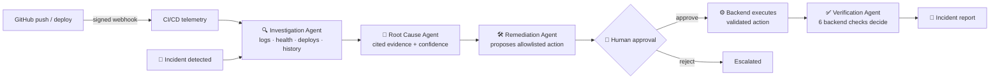

<div align="center">

```text
 ███   ████   ████  ████   ███  █      ███  █████
█   █  █   █  █     █   █   █   █     █   █   █
█   █  ████    ███  ████    █   █     █   █   █
█   █  █          █ █       █   █     █   █   █
 ███   █      ████  █      ███  █████  ███    █
```

### AI-Powered Autonomous Incident Response & DevOps Copilot

**Investigates incidents from real evidence · finds the root cause · waits for a human · fixes · verifies · reports**

[](https://github.com/shamil-tp/OopsPilot/actions/workflows/backend-ci.yml)
[](https://github.com/shamil-tp/OopsPilot/actions/workflows/frontend-ci.yml)
[](https://github.com/shamil-tp/OopsPilot/actions/workflows/docker.yml)


[Quick start](#-quick-start) · [How it works](#-how-it-works) · [Demo](#-demo-flow) · [Architecture](#-architecture) · [API](#-api-overview) · [Docs](docs/)

</div>

---

> **The AI proposes. The backend validates. A human approves risky actions. The backend executes
> only allowlisted actions. Verification decides, not the model.**

OpsPilot is an **AI agent system, not a chatbot**. When a service starts failing, it gathers
structured evidence (logs, health metrics, deployments, previous incidents, GitHub CI/CD events
and AI code reviews), identifies the most likely root cause **with citations**, proposes a safe
remediation, **waits for human approval**, has the approved action carried out, verifies recovery
with objective checks, and writes the incident report.

It runs in two modes:

| Mode | What it does |
| --- | --- |
| 🧪 **Demo mode** | A deterministic, repeatable payment-api scenario: one click on *Simulate incident*, one click on *Reset demo*. |
| 🌐 **Real projects** | Your live apps are health-checked continuously, incidents open automatically, and every push to `main` gets an AI code review. |

## 📑 Contents

- [The problem](#-the-problem)
- [How it works](#-how-it-works)
- [Features](#-features)
- [Quick start](#-quick-start)
- [Demo flow](#-demo-flow)
- [Architecture](#-architecture)
- [Monitoring your own projects](#-monitoring-your-own-projects)
- [API overview](#-api-overview)
- [Configuration](#%EF%B8%8F-configuration)
- [Testing & CI/CD](#-testing--cicd)
- [Security & AI safety](#-security--ai-safety)
- [Limitations](#%EF%B8%8F-limitations)
- [Roadmap](#%EF%B8%8F-roadmap)
- [Team](#-team)

## 🔥 The problem

When a service suddenly starts failing, on-call engineers piece the story together by hand: which
errors started when, what changed (a deploy? a config?), whether dependencies are healthy, whether
this happened before, what is safe to do, and whether the fix actually worked. It's slow,
error-prone and hard to explain afterwards.

Asking a chatbot "what is wrong?" doesn't solve it either: a chatbot has no evidence, can invent
causes, and must never be allowed to change production.

## 🧠 How it works

OpsPilot runs a closed, explainable loop over evidence that the **backend** collects:



Four logical agents share **one AI provider and one Gemini key pool**, coordinated by a central
orchestrator that owns state, tool permissions, the approval gate, retries and event broadcasting.

| Agent | Job | AI calls |
| --- | --- | --- |
| **Investigation** | Read-only tools gather bounded evidence (±10 min of logs, health vs. baseline, deployments, previous incidents, CI/CD events) | 1 |
| **Root Cause** | Correlates timestamps and produces the most likely cause, a causal chain, ruled-out alternatives and a confidence, citing evidence ids (`L5`, `D1`, `C3`, …) | 1 |
| **Remediation** | Proposes one of `ROLLBACK_DEPLOYMENT`, `RESTART_SERVICE`, `NO_ACTION`, `ESCALATE_TO_HUMAN`. Risk and approval come from **backend policy**, not the model | 1 |
| **Verification** | Six deterministic backend checks decide `RESOLVED` or `FAILED`; the AI only writes the summary | 1 |
| **Report** | Assembled from stored results | 0 |

## ✨ Features

- 🔍 **Evidence-based investigation.** Only relevant, time-windowed evidence is sent to the model.
  Every claim cites an evidence id, and unknown ids are dropped.
- 👤 **Human-in-the-loop remediation.** Approve and Reject take **no request body**, so a client
  can't change what gets executed.
- ✅ **Objective verification.** Recovery is measured (error rate, latency, status), never guessed.
- 📡 **Live dashboard.** A WebSocket event stream shows every agent step, with REST polling as a
  fallback.
- 🐙 **GitHub integration.** HMAC-verified webhooks (push, workflow runs, deployment statuses) are
  idempotent on delivery id and become CI/CD evidence (`C1`, `C2`, …).
- 🧾 **AI code review on every push** to a monitored project's main branch. Each issue comes with
  its severity, file:line, explanation and fix. Secrets are redacted first.
- 📄 **Reports.** Incident reports, code reviews and project summaries download as Markdown, JSON
  or PDF.
- 🔑 **Gemini key pool.** Round-robin over 4 keys, with cooldown on rate limits, fallback and
  per-key stats. Keys are never logged.
- 🖥️ **Terminal-style UI.** A macOS Terminal-inspired dashboard: every section is a terminal
  window, with bash prompts and a blinking cursor.

## 🚀 Quick start

**Prerequisites:** Python 3.11+ (CI uses 3.13), Node.js 22, a PostgreSQL database (the team uses
[Supabase](https://supabase.com)), and at least one
[Gemini API key](https://aistudio.google.com/apikey).

```bash
git clone https://github.com/shamil-tp/OopsPilot.git
cd OopsPilot
cp .env.example .env          # set DATABASE_URL and GEMINI_API_KEY_1..4
```

<details open>
<summary><b>Option A: local development</b></summary>

```bash
# Backend
cd backend
python -m venv .venv
.venv/Scripts/activate        # Windows  (macOS/Linux: source .venv/bin/activate)
pip install -r requirements-dev.txt
alembic upgrade head          # create the schema
uvicorn app.main:app --reload --port 8000

# Frontend (second terminal)
cd frontend
npm ci
npm run dev
```

</details>

<details>
<summary><b>Option B: Docker Compose</b></summary>

```bash
docker compose up --build
docker compose run --rm backend alembic upgrade head   # only when there are new migrations
```

</details>

| URL | What |
| --- | --- |
| http://localhost:3000 | Dashboard |
| http://localhost:8000/docs | OpenAPI / Swagger UI |
| http://localhost:8000/api/system/health | App, database and AI provider status |

Then click **Reset demo** → **Simulate incident** and follow the [demo flow](#-demo-flow).

<details>
<summary><b>Database setup details (Supabase)</b></summary>

1. Create a project at [supabase.com](https://supabase.com) and note the database password.
2. Open **Connect** and copy the **Session pooler** connection string
   (`postgres.<project-ref>@aws-0-<region>.pooler.supabase.com:5432`).
   - The *session pooler* works over IPv4 (including from Docker) and supports asyncpg's prepared
     statements.
   - The *direct connection* is IPv6-only unless you buy the IPv4 add-on.
   - The *transaction pooler* (port 6543) breaks prepared statements, so don't use it.
3. Put it in `.env` as `DATABASE_URL`, URL-encoding special characters in the password
   (`@` → `%40`, `/` → `%2F`, `#` → `%23`). `postgresql://` is converted to
   `postgresql+asyncpg://` automatically, and SSL is required for Supabase hosts.
4. Create the schema with `alembic upgrade head`, or paste
   [`docs/supabase-schema.sql`](docs/supabase-schema.sql) into the Supabase SQL Editor. Use one or
   the other, not both.
5. Check it with `python -m scripts.check_database`. It verifies the connection, the revision, all
   tables, RLS, and CRUD inside a transaction that is always rolled back.

> ⚠️ The Supabase database is shared by the whole team. Never run `alembic downgrade` against it,
> and coordinate before applying a new migration.

</details>

## 🎬 Demo flow

The full 5–7 minute script, with timings and emergency recovery, is in [`docs/demo.md`](docs/demo.md).

```text
Reset ─▶ GitHub push + deploy-production (v1.8.2) ─▶ Simulate Incident (INC-001, HIGH, 37% / 2800 ms)
─▶ Investigate ─▶ Root cause ─▶ Propose remediation (rollback v1.8.2 → v1.8.1)
─▶ APPROVE (human) ─▶ rollback executes ─▶ Verify (0.8% / 180 ms) ─▶ RESOLVED ─▶ Report
```

| Metric | Before | After |
| --- | --- | --- |
| Error rate | 37 % | 0.8 % |
| Latency | 2800 ms | 180 ms |
| Status | `DEGRADED` | `HEALTHY` |

The data never states the cause. The agents have to infer it:

```text
deploy v1.8.2 (config change) → database connection failures → POST /payment 500s → 37% errors, 2800 ms
```

<details>
<summary><b>Run the whole lifecycle from the API (no browser)</b></summary>

```bash
curl -X POST localhost:8000/api/demo/reset                 # healthy, payment-api v1.8.1, no incidents
python -m scripts.send_github_webhook                      # optional: signed GitHub push + deploy
curl -X POST localhost:8000/api/incidents/simulate         # INC-001, HIGH, DETECTED
curl -X POST localhost:8000/api/incidents/1/investigate    # INVESTIGATING      (1 Gemini call)
curl -X POST localhost:8000/api/incidents/1/analyze        # ANALYZING          (1 Gemini call)
curl -X POST localhost:8000/api/incidents/1/remediate      # AWAITING_APPROVAL  (rollback v1.8.2 → v1.8.1)
curl -X POST localhost:8000/api/incidents/1/approve        # backend executes the stored rollback (no AI)
curl -X POST localhost:8000/api/incidents/1/verify         # 6 backend checks → RESOLVED (1 Gemini call)
curl localhost:8000/api/incidents/1/report                 # stored report (no AI)
```

Repeating a step is safe: it returns the stored result, with no new AI call and no new
execution. Steps out of order return `409`.

</details>

**Incident states**, used the same way in the backend and frontend:
`DETECTED → INVESTIGATING → ANALYZING → AWAITING_APPROVAL → REMEDIATING → VERIFYING → RESOLVED`
(or `FAILED` / `ESCALATED`).

## 🏗️ Architecture

```text
 GitHub ──signed webhook──▶ ┌──────────────────────────── FastAPI backend ─────────────────────────────┐
                            │ /api/webhooks/github → verify HMAC → normalize → cicd_events → deployments│
 Next.js dashboard ◀─REST──▶│ /api/incidents/...   REST commands + state                                │
   (React, Tailwind,  ◀─WS──│ /ws/incidents/{id}   live agent events                                    │
    Framer Motion)          │                                                                           │
                            │ Agents (one shared AI provider):                                          │
                            │   Investigation ─▶ Root Cause ─▶ Remediation ─▶ [Human approval gate]     │
                            │   ─▶ Execution (backend) ─▶ Verification ─▶ Report (no AI)                │
                            │ Read-only tool allowlist · remediation policy · state machine · key pool  │
                            └──────────────┬─────────────────────────────────────────┬──────────────────┘
                                           │ SQLAlchemy + asyncpg                    │ google-genai
                                           ▼                                         ▼
                              Supabase PostgreSQL (RLS on)            Gemini gemini-3.1-flash-lite
                                                                      (4-key pool: round-robin,
                                                                       cooldown, fallback)
```

- **REST** handles commands and persistent state. **WebSocket** handles live events only.
- **Supabase is used only as managed PostgreSQL.** Only the backend talks to it, and the browser
  never gets database credentials. RLS is enabled on every table with no policies, which locks
  out Supabase's public Data API.
- **The AI provider is swappable.** `AIProvider` → `GeminiProvider` today, `OllamaProvider`
  (Qwen, local/offline) planned. Business logic never imports Gemini directly.

| Layer | Technology |
| --- | --- |
| Frontend | Next.js (App Router), React, TypeScript (strict), Tailwind CSS, Framer Motion |
| Backend | Python, FastAPI, Pydantic, SQLAlchemy (async) + asyncpg, Alembic, Uvicorn |
| Database | PostgreSQL on Supabase |
| AI | Google Gemini (`gemini-3.1-flash-lite`) behind an `AIProvider` interface |
| DevOps | Docker, Docker Compose, GitHub Actions, GitHub Webhooks |

<details>
<summary><b>Repository layout</b></summary>

```text
.
├── backend/                 FastAPI + SQLAlchemy (async) + Alembic
│   ├── app/
│   │   ├── api/             REST routes (/api/...)
│   │   ├── agents/          investigation, root cause, remediation, verification; approval gate; report
│   │   ├── ai/              AIProvider interface, Gemini provider, key pool, factory
│   │   ├── core/            settings, structured logging
│   │   ├── db/              engine, session, declarative base
│   │   ├── github/          webhook signature verification, payload normalization, demo deliveries
│   │   ├── models/          ORM models + domain enums
│   │   ├── prompts/         concise agent prompts
│   │   ├── schemas/         Pydantic request/response models
│   │   ├── services/        simulated environment, telemetry, CI/CD ingestion, business logic
│   │   ├── tools/           tool registry, permissions, read-only telemetry/CI-CD tools
│   │   ├── websocket/       live incident event stream
│   │   └── main.py
│   ├── alembic/             database migrations
│   ├── scripts/             check_database, send_github_webhook, link_cicd_events
│   └── tests/
├── frontend/                Next.js (App Router) + TypeScript + Tailwind + Framer Motion
│   └── app/  components/  hooks/  lib/  types/
├── docs/                    architecture, agent design, API, GitHub webhooks, demo script, final QA
├── .github/workflows/       backend CI, frontend CI, Docker build + smoke test
├── docker-compose.yml       backend + frontend (the database is Supabase)
└── .env.example
```

</details>

More detail: [`architecture.md`](docs/architecture.md) · [`agent-design.md`](docs/agent-design.md)
· [`github-webhooks.md`](docs/github-webhooks.md) · [`api.md`](docs/api.md) · [`demo.md`](docs/demo.md)

## 🌐 Monitoring your own projects

You don't need a CI/CD pipeline. For each application:

1. Add it to `MONITORED_PROJECTS` in `.env`:
   ```env
   MONITORED_PROJECTS=[{"name":"Mallu Typing","service":"mallutyping-web","url":"https://mallutyping.nihalt.in","repository":"MrNihalT/mallutyping"}]
   ```
2. In the GitHub repository, go to **Settings → Webhooks → Add webhook**:
   - Payload URL: `https://<your-backend>/api/webhooks/github`
   - Content type: `application/json`. Secret: the value of `GITHUB_WEBHOOK_SECRET`.
   - Events: **Pushes** and **Deployment statuses** (Workflow runs are optional).
3. Optional: set a read-only `GITHUB_TOKEN` for private repositories.
4. Restart the backend. The project appears on the Overview with its own page.

| Trigger | What OpsPilot does |
| --- | --- |
| Every health check (60 s) | Records status and response time. 2 DOWN checks (or 3 failing checks) in a row open an incident. |
| New incident | Investigates, finds the likely root cause and proposes a fix, then **waits for human approval**. |
| Approved action | An operator performs it and clicks *Mark as done*. OpsPilot verifies recovery from the next health checks. |
| Push to `main` | Runs an AI code review: each issue with severity, file:line, explanation and fix. |

## 🔌 API overview

Full reference: [`docs/api.md`](docs/api.md) and the OpenAPI docs at `/docs`.

| Method | Path | Purpose |
| --- | --- | --- |
| `POST` | `/api/incidents/simulate` | Create the simulated payment-api incident |
| `GET` | `/api/incidents` · `/api/incidents/{id}` | List incidents / get one incident |
| `POST` | `/api/incidents/{id}/investigate` · `/analyze` · `/remediate` | Run the agent steps |
| `POST` | `/api/incidents/{id}/approve` · `/reject` | Human decision on the pending action |
| `POST` | `/api/incidents/{id}/verify` | Backend recovery checks → `RESOLVED` / `FAILED` |
| `GET` | `/api/incidents/{id}/events` · `/report` | Agent timeline / final report |
| `WS` | `/ws/incidents/{id}` | Live agent and CI/CD events |
| `POST` | `/api/webhooks/github` | GitHub webhook (HMAC-verified) |
| `POST` | `/api/demo/reset` | Reset to a healthy environment |
| `GET` | `/api/system/health` | App, database and AI provider status |

<details>
<summary><b>All endpoints</b></summary>

| Method | Path | Purpose |
| --- | --- | --- |
| `GET` | `/api/system/health` | App, database, and AI provider status |
| `POST` | `/api/incidents/simulate` | Create the simulated payment-api incident (idempotent while active) |
| `GET` | `/api/incidents` | Incidents, newest first |
| `GET` | `/api/incidents/{id}` | Incident details (`404` if unknown) |
| `POST` | `/api/incidents/{id}/investigate` | Run the Investigation Agent (read-only tools + 1 structured AI call) |
| `GET` | `/api/incidents/{id}/investigation` | Latest investigation (evidence incl. CI/CD) |
| `GET` | `/api/incidents/{id}/events` | Agent timeline, oldest first |
| `POST` | `/api/incidents/{id}/analyze` | Run the Root Cause Analysis Agent (1 structured AI call) |
| `GET` | `/api/incidents/{id}/analysis` | Latest root cause analysis |
| `POST` | `/api/incidents/{id}/remediate` | Run the Remediation Agent: validated proposal + PENDING approval (no execution) |
| `GET` | `/api/incidents/{id}/remediation` | Latest remediation proposal and approval |
| `POST` | `/api/incidents/{id}/approve` | Approve the pending proposal; backend executes it |
| `POST` | `/api/incidents/{id}/reject` | Reject the pending proposal; incident escalated |
| `GET` | `/api/incidents/{id}/execution` | Execution of the approved remediation |
| `POST` | `/api/incidents/{id}/execution/confirm` | Operator marks the approved action as performed (real projects) |
| `POST` | `/api/incidents/{id}/verify` | Run the Verification Agent: backend recovery checks → RESOLVED or FAILED |
| `GET` | `/api/incidents/{id}/verification` | Latest verification result |
| `GET` | `/api/incidents/{id}/report` | Final incident report (stored once after verification) |
| `GET` | `/api/services` | Services and their current status |
| `GET` | `/api/services/projects` | Monitored real projects (name, URL, repository) |
| `GET` | `/api/services/{name}/health` | Latest health snapshot |
| `GET` | `/api/services/{name}/health/history` | Recent health checks (`limit` ≤ 100) |
| `GET` | `/api/services/{name}/logs` | Logs; filter by `level`, `since`, `until`, `limit` |
| `GET` | `/api/services/{name}/deployments` | Deployment history, newest first |
| `WS` | `/ws/incidents/{id}` | Live agent/CI-CD events for one incident |
| `POST` | `/api/webhooks/github` | GitHub webhook (HMAC-verified): push, workflow_run, deployment_status |
| `GET` | `/api/webhooks/github/status` | Webhook configuration (never the secret) |
| `GET` | `/api/cicd/events` · `/api/cicd/events/{id}` | Normalized CI/CD events |
| `GET` | `/api/code-reviews` · `/api/code-reviews/{id}` | AI code reviews of pushes |
| `POST` | `/api/code-reviews/{id}/retry` | Retry a FAILED review (`409` otherwise) |
| `POST` | `/api/demo/reset` | Reset to a healthy environment with no incidents |

</details>

## ⚙️ Configuration

All configuration comes from environment variables. [`.env.example`](.env.example) has the full,
commented list. The essentials:

| Variable | Purpose |
| --- | --- |
| `DATABASE_URL` | **Required.** PostgreSQL / Supabase session-pooler connection string |
| `GEMINI_API_KEY_1` … `GEMINI_API_KEY_4` | Gemini keys shared by all agents through the key pool (never logged) |
| `GEMINI_MODEL` | Model used by the agents (default `gemini-3.1-flash-lite`) |
| `GITHUB_WEBHOOK_SECRET` | HMAC secret for GitHub webhooks. If unset, deliveries are rejected (503) |
| `DEMO_MODE` | `true` (default) enables the simulated scenario. `false` turns off Simulate and Reset |
| `MONITORED_PROJECTS` | Real apps to watch, as JSON `[{"name","service","url","repository"}]` |
| `NEXT_PUBLIC_API_URL` | API URL used by the browser (baked in at frontend build time) |

<details>
<summary><b>Advanced settings</b></summary>

| Variable | Purpose |
| --- | --- |
| `DB_POOL_SIZE`, `DB_MAX_OVERFLOW` | Connections per backend (3 + 4). Supabase's session pooler allows about 15 for the whole project |
| `TEST_DATABASE_URL` | Separate database for the test suite (defaults to local SQLite) |
| `GEMINI_KEY_COOLDOWN_SECONDS` | How long a rate-limited key is skipped (default 60; Gemini's own retry delay wins when given) |
| `LLM_TIMEOUT_SECONDS`, `LLM_TEMPERATURE`, `LLM_MAX_OUTPUT_TOKENS` | Defaults for every LLM request (30 / 0.2 / 2048) |
| `AI_PROVIDER` | `gemini` (Ollama + Qwen planned) |
| `MAX_AGENT_STEPS`, `LLM_MAX_RETRIES`, `TOOL_MAX_RETRIES` | Agent loop safety limits (8 / 2 / 2) |
| `GITHUB_REPOSITORY`, `GITHUB_SERVICE` | Optional repository allowlist and the service it deploys |
| `INCIDENT_DOWN_CHECKS`, `INCIDENT_DEGRADED_CHECKS`, `AUTO_RESPOND`, `VERIFY_MIN_CHECKS` | Incident Manager thresholds for real projects |
| `CODE_REVIEW_ENABLED`, `GITHUB_TOKEN`, `CODE_REVIEW_MAX_DIFF_CHARS` | AI review of each push (diff capped at 60 000 characters) |
| `MONITORED_HEALTH_INTERVAL_SECONDS`, `MONITORED_LATENCY_SLO_MS` | Health-check interval (60 s) and degraded-latency threshold (3000 ms) |
| `CORS_ORIGINS` | Comma-separated origins allowed to call the API |

</details>

<details>
<summary><b>How the Gemini key pool works</b></summary>

- **Round-robin** over the configured keys. Keys appear in logs only as `gemini-key-<n>`.
- **Fallback:** a retryable failure (429 rate limit or quota, invalid key, 5xx, timeout, network
  error) moves to the next available key, with at most `1 + LLM_MAX_RETRIES` attempts per request.
- **Cooldown:** a rate-limited key is skipped for Gemini's suggested delay or
  `GEMINI_KEY_COOLDOWN_SECONDS`, and a rejected key for 15 minutes. Keys are never disabled
  permanently.
- **No retry** for malformed requests (400) or an unknown model (404). Those fail immediately with
  a clear error.
- **Structured output:** `generate_structured(prompt, PydanticModel)` returns a validated instance
  or raises `AIStructuredOutputError`.
- **Token efficiency:** small prompts, time-windowed evidence, at most 3–5 previous incidents, tool
  results cached per incident, and JSON-only outputs.

</details>

Never commit `.env`, API keys, database passwords or webhook secrets. The frontend only ever gets
`NEXT_PUBLIC_API_URL`.

## 🧪 Testing & CI/CD

```bash
cd backend
ruff check . && ruff format --check .
pytest                                  # local SQLite file by default

cd ../frontend
npm run lint && npm run typecheck && npm run build
```

Tests build the schema through the real Alembic migrations and then migrate down to an empty
schema. They **refuse to start if `TEST_DATABASE_URL` points at the same database as
`DATABASE_URL`**, so never point it at the shared Supabase database.

| Workflow | What it does |
| --- | --- |
| `backend-ci.yml` | Ruff lint/format, pytest against a disposable PostgreSQL, `alembic check` for migration drift |
| `frontend-ci.yml` | `npm ci`, ESLint, TypeScript, production build |
| `docker.yml` | Builds both images, starts Compose and smoke-tests the backend, the webhook and the dashboard |

CI never needs real secrets: Gemini and GitHub are faked in tests, and the database is a disposable
container.

## 🔒 Security & AI safety

| The AI **can** | The AI **cannot** |
| --- | --- |
| read evidence through allowlisted, bounded, read-only tools | run shell commands, arbitrary SQL or arbitrary HTTP, or touch the filesystem |
| propose a root cause with citations | invent evidence (unknown citation ids are dropped) |
| propose one of four allowlisted actions | choose the risk level, whether approval is needed, or an unvalidated target |
| explain the verification result | decide recovery or resolve an incident |

The **backend** controls tool allowlists and argument bounds, Pydantic validation, the incident
state machine, remediation policy (risk, approval, version validation against real deployment
history), execution (re-validated, exactly the stored parameters, once) and verification. A
**human** approves every risky remediation. GitHub webhooks are HMAC SHA-256 verified, size-limited,
idempotent and stored as data only. Secrets never appear in logs, API responses, WebSocket messages
or the browser bundle.

## ⚠️ Limitations

- **No infrastructure control.** In demo mode, services and the rollback are simulated. For real
  projects, OpsPilot observes and recommends, and an operator performs the approved action.
- **One scenario.** The demo tells one deterministic story (the payment-api v1.8.2 regression).
- **LLM wording varies** between runs. The backend guarantees citations, schema, actions and
  outcome, not wording. The root cause is the *most likely* cause, not a proof.
- **No authentication.** The API is meant for local or demo use. Put it behind authentication
  before exposing it.
- **Shared database.** *Reset demo* clears all incidents in the configured database.
- **Times are UTC** everywhere.
- **Code review sends code to Gemini:** only the changed lines of a push, with secrets redacted.
  Turn it off with `CODE_REVIEW_ENABLED=false`.

## 🗺️ Roadmap

- [x] Simulated environment, four agents, human approval, verification, report
- [x] Real-time dashboard, GitHub webhooks and CI/CD telemetry
- [x] Real project monitoring, automatic incident response, AI code review on push
- [ ] **Ollama + Qwen** provider for local, offline inference (the interface is ready)
- [ ] Multiple simultaneous incidents and services
- [ ] Prometheus-style metrics and container health
- [ ] Authentication for non-local deployments

## 👥 Team

Built by a 4-person student hackathon team.

| Role | Owns |
| --- | --- |
| AI / Agents (everyone) | `backend/app/agents/`, `backend/app/ai/`, `backend/app/prompts/` |
| Backend / DevOps simulation (everyone) | `backend/app/api/`, `tools/`, `services/`, `models/`, `db/` |
| Frontend: Gifty, Ektha & Shamil | `frontend/` |
| Integration / CI-CD / QA: Nihal & Shamil | `.github/`, `docs/`, `docker-compose.yml`, tests |

Final QA notes: [`docs/final-qa.md`](docs/final-qa.md)
